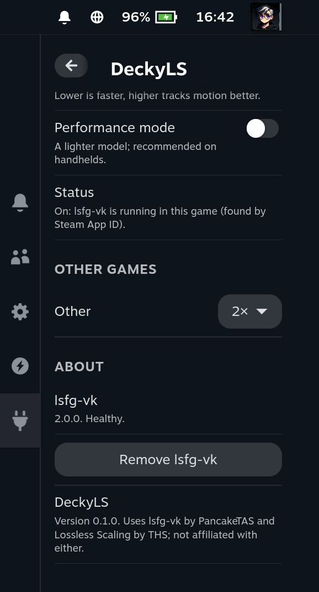
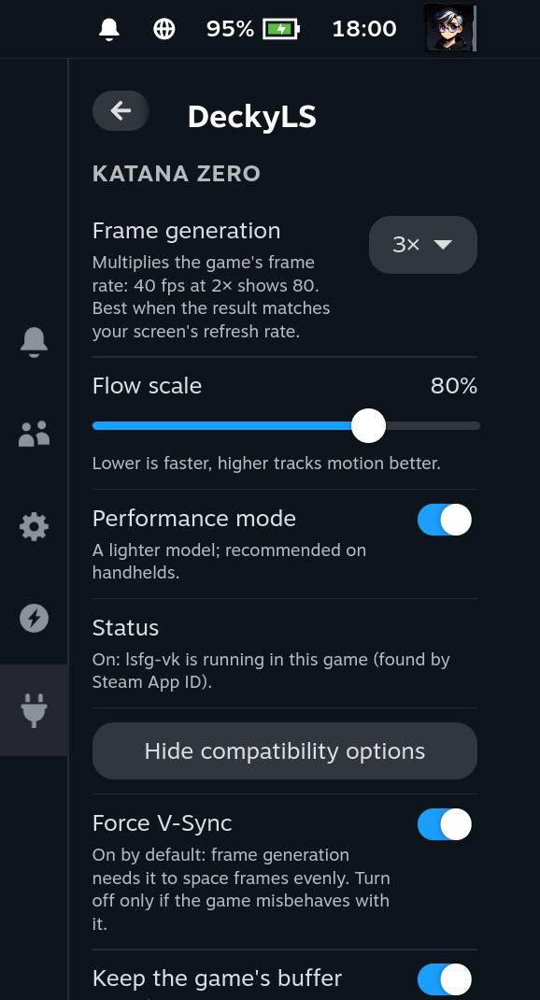
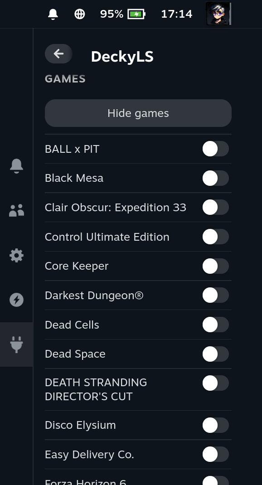

<div align="center">

# DeckyLS

[](https://github.com/Rayekkk/DeckyLS/releases/latest)
[](https://github.com/Rayekkk/DeckyLS/releases)
[](https://lsfg-vk.dev)
[](https://decky.xyz)
[](#license)

**Lossless Scaling frame generation on SteamOS, for the game you are playing.**
Open the Quick Access Menu, pick 2×, play. Built on the official, unmodified lsfg-vk 2.0: no launch options, no environment variables, nothing added to your games.

[Features](#features) · [Requirements](#requirements) · [Installation](#installation) · [Quick start](#quick-start) · [Troubleshooting](#troubleshooting) · [How it works](#how-it-works) · [AI disclaimer](#ai-disclaimer)

</div>

---

## Features

[lsfg-vk](https://lsfg-vk.dev) by PancakeTAS brings Lossless Scaling's frame generation to Linux
as a Vulkan layer. Version 2.0 finds a game by its Steam App ID and reloads its settings while the
game runs, so a launch option is no longer needed. DeckyLS installs lsfg-vk, gives you one menu
for the running game and tells you whether frame generation really runs.

| Feature | What you get |
|---|---|
| **One-tap setup** | Installs the official lsfg-vk 2.0.0 from its author's site and checks it against a pinned hash |
| **One menu** | Frame generation **Off / 2× – 8×**, flow scale and performance mode for the game you are playing |
| **FPS counter** | The game's own frame rate in Steam's performance overlay, for example **LSFG 3x - base 48 FPS** |
| **Compatibility options** | Folded away until a game needs them: **Force V-Sync** and **Keep the game's buffer count**, plus a global **Half precision (FP16)** switch |
| **All your games** | Every installed game in alphabetical order, Steam and non-Steam, with an On / Off switch to prepare it before you start it |
| **Live changes** | Every change reaches the running game within a second |
| **No launch options** | Your games' launch options stay untouched, so other launch-option tools keep working |
| **Honest status** | Shows whether lsfg-vk joined the game and how it found it, lsfg-vk's own health check, a missing Lossless Scaling or the wrong Steam branch |
| **Conflict warning** | Names other installed plugins that also manage lsfg-vk |
| **Your settings stay** | Profiles DeckyLS did not create are kept, and your config file is backed up before the first change |
| **Clean removal** | **Remove lsfg-vk** deletes exactly the files DeckyLS installed |

## Requirements

| Requirement | Details |
|---|---|
| System | SteamOS in Gaming Mode (or another x86_64 Linux) with [Decky Loader](https://decky.xyz) |
| Lossless Scaling | Bought and installed from [Steam](https://store.steampowered.com/app/993090/Lossless_Scaling/), switched to the **lsfg-vk** branch: **Lossless Scaling → Properties → Betas → lsfg-vk** |
| Games | Games that render through Vulkan, which includes Proton games (DirectX through DXVK or VKD3D-Proton). OpenGL games are not supported by lsfg-vk |
| Network | Once, to download lsfg-vk from `builds.lsfg-vk.dev` |

Tested on a Legion Go 2 (SteamOS, Decky Loader 3.3) with Nine Sols under Proton 11. Flatpak apps
(for example emulators from Flathub) are not supported yet.

## Installation

1. Install [Decky Loader](https://decky.xyz) if you do not already have it.
2. Download `DeckyLS-<version>.zip` from [Releases](https://github.com/Rayekkk/DeckyLS/releases).
3. In Gaming Mode, open **Quick Access Menu → Decky → Settings**, turn on **Developer mode** under
   **General**, then open **Developer**.
4. Choose **Install Plugin from ZIP**, select the archive, then open **DeckyLS** in Decky.
5. Press **Install lsfg-vk 2.0.0**.

### Updating

Install the newer ZIP the same way. lsfg-vk and your game settings stay as they are. When a release
comes with a newer lsfg-vk, **About** offers **Update lsfg-vk to …**.

<a href="docs/screenshots/about.png"></a>

### Uninstalling

Press **About → Remove lsfg-vk** first, then uninstall DeckyLS in Decky. Decky handles an update as
uninstall plus install, so the plugin never removes lsfg-vk on its own. Your game settings stay in
`~/.config/lsfg-vk/conf.toml`; delete that folder too for a full cleanup.

## Quick start

<a href="docs/screenshots/panel.png"></a>

1. Open **Quick Access Menu → DeckyLS → Show games** and turn your game **On**. lsfg-vk is now
   ready in it; frame generation itself stays at 1×.
2. Start the game and open DeckyLS again. The game is at the top of the panel: choose **2×**, **3×**
   or **4×**, and adjust **Flow scale** and **Performance mode**. Every change applies live.
3. **Status** shows **On** when frame generation runs in the game.

**Off** in the game's menu stops frame generation but keeps lsfg-vk ready, so turning it on again
later works live. **Off** in the games list keeps lsfg-vk out of the game completely.

lsfg-vk joins a game when it starts. If you choose a multiplier for a game that is already running
and was never turned on in the list, restart it once.

<a href="docs/screenshots/games.png"></a>

| Status | Meaning |
|---|---|
| On: lsfg-vk is running in this game | Frame generation runs; the panel says how lsfg-vk recognised the game |
| Restart the game to start frame generation | The game was started before it was turned on in the games list |
| lsfg-vk uses the profile "…" for this game | Another profile matches the game first (for example one made by another tool); change that one under **Games** |
| Off | Frame generation is off for this game; choose 2×, 3× or 4× to start it |

**FPS counter:** Steam's performance overlay counts the frames on screen, generated ones included. Turn on
**All games → FPS counter** and, at overlay levels 2 to 4, it also shows the game's own rate, for example
**LSFG 3x - base 48 FPS**. The screen cannot show more than its refresh rate, so a game at 60 fps set to 3×
on a 144 Hz screen slows down to 48; the counter makes that visible. Without frame generation the overlay
stays exactly as Steam makes it.

**Tips:** frame generation needs a steady base frame rate; cap the game a little below what it
reaches (for example 40 fps for 80 fps at 2×). Lower **Flow scale** costs less GPU time, higher
follows fast motion better. **Performance mode** uses a lighter model that suits handheld GPUs.

## Troubleshooting

| What you see | What to do |
|---|---|
| "Install Lossless Scaling from Steam…" | Buy and install Lossless Scaling; lsfg-vk uses its files |
| "In Steam, open Lossless Scaling → Properties → Betas…" | Switch Lossless Scaling to the **lsfg-vk** branch and let Steam update it |
| Status still says restart after a restart | The game does not render through Vulkan (for example a native OpenGL game). If it has a Windows version, try it with Proton |
| "Also installed: …" | Another plugin manages lsfg-vk too (Decky LSFG-VK, MAKO). Keep only one; uninstall the other |
| "lsfg-vk is already installed by something else" | DeckyLS uses that installation. Remove it with the tool that installed it if you want DeckyLS to manage lsfg-vk |
| "…conf.toml cannot be read…" | Fix or delete `~/.config/lsfg-vk/conf.toml`; DeckyLS never overwrites a file it cannot read. Your earlier file is in `conf.toml.bak-deckyls` |
| **About** shows a health-check report instead of **Healthy** | Follow what it says; it comes from lsfg-vk's own `lsfg-vk-cli healthcheck` |
| Ghosting or wobbly edges | Raise **Flow scale**, turn off **Performance mode**, or raise the base frame rate |
| The game crashes or freezes with frame generation | Open **Compatibility options**, turn on **Keep the game's buffer count** and restart the game |
| The game stutters or misbehaves only with frame generation | Try **Compatibility options → Force V-Sync** off and restart the game; turn it back on if frame pacing gets uneven |
| Download failed | Read the error and retry; nothing is installed from a failed or mismatched download |

**Reporting a problem:** include the DeckyLS version, SteamOS version, the game, whether it runs on
Proton, and what the panel says. [CHANGELOG.md](CHANGELOG.md) lists the changes in each version.

## How it works

<details>
<summary><b>lsfg-vk, its config file and the status</b></summary>

lsfg-vk is a Vulkan layer. When a game starts, it reads `~/.config/lsfg-vk/conf.toml` and looks
for a profile whose `active_in` matches the game: its Steam App ID, its executable or its process
name. It then watches the file and reloads it whenever it changes.

DeckyLS writes one profile per game:

```toml
[[profile]]
name = "Nine Sols"
active_in = "1809540"
multiplier = 2
flow_scale = 1.0
performance_mode = true
```

The **Games** list comes from Steam's own files, without starting anything: the app manifests in
every Steam library (internal drive and SD card; Proton, Steam Linux Runtime and Lossless Scaling
itself are left out) and the non-Steam shortcuts in `shortcuts.vdf`. Non-Steam games also get their
executable name (for example `"Game.exe"`) from the shortcut, or from the command line Steam
started them with. A game turned **On** in the list gets a profile with `multiplier = 1`, lsfg-vk's own
off switch: lsfg-vk joins the game at its start but generates no frames until you choose 2× or more.
**Off** in the list removes the game from its profile. lsfg-vk rejects a file without profiles, so
when the last game goes, a placeholder profile that matches no game takes its place.
Everything else in the file, including profiles from other tools, is written back unchanged and
checked by reading the result back before it replaces the file; comments are not kept, so your
original file is copied once to `conf.toml.bak-deckyls`.

lsfg-vk logs through the Steam client into the user journal. The **Status** line reads the profile
lsfg-vk picked since the game started (`journalctl --user`) and compares it with the game's
profile.

The **FPS counter** reads gamescope's stats pipe (`/run/user/<uid>/gamescope.*/stats.pipe`), which reports
the rate of the frames the game hands gamescope, generated ones included; nothing else on SteamOS reads it,
and DeckyLS reads it only while the counter is on. The game's own rate is that divided by the multiplier,
shown only once lsfg-vk's log says it joined the game. DeckyLS writes that line to
`$XDG_RUNTIME_DIR/deckyls/fps` at least every second and adds it to Steam's overlay (mangoapp, MangoHud)
with `~/.config/MangoHud/presets.conf`: levels 2 to 4 `inherit` Steam's own presets and get one `exec`
item first, which prints the file only while it is fresh. mangoapp runs that command itself every half
second; it is a separate process, so games are not slowed down. A presets file DeckyLS did not write is
never changed.

lsfg-vk is not part of the plugin. It is licensed CC BY-NC-ND 4.0, so DeckyLS never changes or
ships it: **Install lsfg-vk** downloads the author's release archive from `builds.lsfg-vk.dev`,
accepts it only if its SHA-256 matches the hash pinned in this release, refuses any entry that
would land outside `~/.local/bin`, `~/.local/lib` and `~/.local/share`, and unpacks it there as
lsfg-vk's own install guide does. The files written are recorded and removed only by **Remove
lsfg-vk**. `npm run package` refuses to build a ZIP that contains any lsfg-vk or Lossless Scaling
file.

</details>

## Development

<details>
<summary><b>Build, test and package from source</b></summary>

Requires Node.js 24 and Python 3.11 or newer.

```bash
npm ci --ignore-scripts --no-audit --no-fund
npm run typecheck      # frontend types
npm run test:frontend  # panel regression tests
npm run test:backend   # Python backend tests
npm run build          # compile the frontend
npm run package        # create DeckyLS-<version>.zip
```

Install the result through Decky's **Install Plugin from ZIP**. GitHub Actions runs the backend
tests on Linux and Windows and checks the frontend and the built ZIP. Steam, Decky and the download
are mocked; game sessions still need testing on the handheld (`tools/device/`: `decky_install.sh`
installs a ZIP through Decky, `lscall.sh` calls the backend like the panel, `cdp.py` drives and
screenshots the Steam UI).

</details>

---

## Credits

- **PancakeTAS** and the [lsfg-vk](https://lsfg-vk.dev) contributors - the frame generation layer this plugin installs and configures
- **THS** and [Lossless Scaling](https://store.steampowered.com/app/993090/Lossless_Scaling/) - the frame generation itself
- [Decky Loader](https://github.com/SteamDeckHomebrew/decky-loader) - the plugin platform

Component licenses are recorded in [NOTICE](NOTICE).

---

## License

Plugin code: BSD 3-Clause - see [LICENSE](LICENSE). lsfg-vk (CC BY-NC-ND 4.0) and Lossless
Scaling are not included and stay under their own licences. Not affiliated with PancakeTAS, THS
or Valve.

---

## AI disclaimer

This project was built with substantial help from an AI coding assistant. The research, the
plugin, the tests and this documentation were written by Anthropic's Claude Code working under my
direction: I set the goal and the requirements (the official lsfg-vk only, unmodified; no launch
options; nothing redistributed that may not be; a status that never pretends), made the decisions
and chose what was released.

The AI was used to:

- compare the existing Lossless Scaling plugins and find what lsfg-vk 2.0 makes possible;
- verify on the device how lsfg-vk 2.0 picks profiles, reloads its config and logs;
- write the Decky plugin, its tests and this documentation.

Nothing here is untested AI output. Every step was tested on my Legion Go 2 in Gaming Mode: the
install from the plugin, a game started with and without a profile, live changes in a running game
and the status the panel shows.

DeckyLS installs lsfg-vk into your home folder and edits its config file. It is provided as is,
without warranty (see [License](#license)); use it at your own risk.
